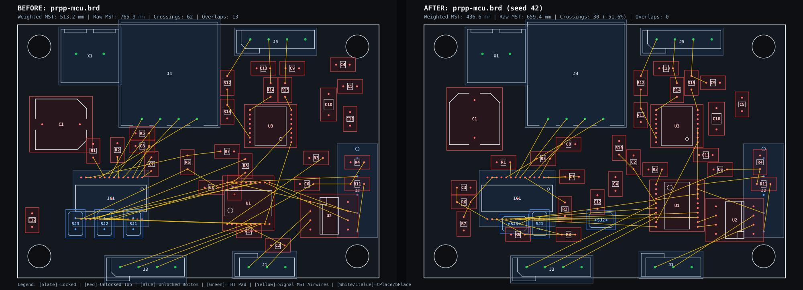

# eagle6-placer

Standalone component auto-placement optimizer for **CadSoft EAGLE v6.6.0** XML board files (`.brd`).

`eagle6-placer` optimizes the positions and `90°` orientations of **unlocked** components (`locked != "yes"`) to improve PCB routability—reducing pin-accurate MST wirelength, untangling signal airwire crossings, and legalizing courtyard overlaps—while emitting **human-reviewable EAGLE `.scr` scripts** instead of mutating your `.brd`/`.sch` XML files directly.

It is designed as a decoupled sibling to [eagle6-mcp](https://github.com/beattidp/eagle6-mcp#readme) (inspection, DRC, rendering, staged script validation) and [eagle6-freerouting](https://github.com/beattidp/eagle6-freerouting#readme) (autorouting), with zero code coupling between repositories.

---

## Example: Before & After (`prpp-mcu.brd`)

On a 41-component, 2-layer STM32 + DRV8825 + FT230XS board (`50 × 35 mm`, 7 locked anchors, 34 unlocked parts), a single `eagle6-placer polish --preview` run achieved:
- **Signal airwire crossings:** `62 → 30` (**-51.6%**)
- **Raw MST wirelength:** `765.9 mm → 659.4 mm` (**-13.9%**)
- **Pre-existing courtyard/hole overlaps:** `13 → 0` (**100% legalized**)
- **EAGLE v6.6.0 staged DRC:** **0 new DRC errors**



*(Full walkthrough: [doc/walkthroughs/2026-11-25_prpp-mcu-polish.md](doc/walkthroughs/2026-11-25_prpp-mcu-polish.md))*

---

## Key Features
- **Safety-First Workflow:** Strictly read-only `.brd` parsing. All edits are emitted as commented EAGLE `.scr` scripts (`ROTATE =R0 'R1';`, `MOVE 'R1' (x y);`, `RATSNEST;`) for staged dry-run validation via `eagle6-mcp` and EAGLE GUI execution with full **Undo**.
- **Sacred Locked Anchors:** Elements with `locked="yes"` (connectors, mounting holes, mechanical parts) are strictly immobile.
- **Keep-Side Default & Dual-Side THT Awareness:** SMD parts remain on their mounted side (top/bottom SMDs may overlap in XY), while THT parts block both sides.
- **Hard Constraints + Soft Overlap Legalization:** Enforces layer `20` board outline minus `mdCopperDimension` edge clearance, keepouts (`tKeepout`/`bKeepout`/`tRestrict`/`bRestrict`), and mechanical `<hole>` avoidance, while actively separating pre-existing courtyard overlaps down to `0` violations.
- **Pin-Accurate Routability Objective:** Euclidean Prim's MST wirelength over exact transformed pad coordinates, non-pour signal airwire crossing count, automatic down-weighting of copper-pour/global nets (`GND`, `VCC`, etc.), optional displacement penalty, and `--proximity-group` clustering for decoupling capacitors and critical subcircuits.
- **Built-In Visual Preview (`--preview`):** Generates high-resolution Before/After SVG (and PNG via ImageMagick) graphics with `tPlace`/`bPlace` silkscreen outlines enabled by default (`--hide-place` to hide).
- **Zero External Runtime Dependencies:** Pure Python 3.10+ standard library.

---

## 3-Tool Decoupled Workflow
```text
  eagle6-mcp             eagle6-placer             eagle6-mcp              eagle6-freerouting
(Pre-audit &    ──▶  (Optimize unlocked    ──▶  (Staged .scr dry-run  ──▶  (Optional autoroute
 lock anchors)        placement → .scr)          + DRC + render)            benchmark)
```

---

## Quickstart

### Installation
```bash
git clone https://github.com/beattidp/eagle6-placer.git
cd eagle6-placer
pip install -e .
```

### Optimize a Board & Generate Before/After Preview
```bash
eagle6-placer polish path/to/board.brd \
  --preview \
  --steps 6000 \
  --seed 42
```

### Keep Decoupling Caps & Critical Subcircuits Together
```bash
eagle6-placer polish path/to/board.brd \
  --preview \
  --steps 6000 \
  --seed 42 \
  --proximity-group U1,C1,C2 \
  --proximity-group U3,C10,C11,R14,R15
```

### Coarse-to-Fine Placement (Fresh Unplaced Board + Multi-Seed Candidates)
```bash
eagle6-placer place path/to/unplaced_board.brd \
  --preview \
  --candidates 3 \
  --keep-all-candidates
```

### Opt-In Double-Sided Mirroring (SMD-Only)
```bash
# Allow mirroring specific capacitor ranges, or all SMDs except U1/IC3:
eagle6-placer polish path/to/board.brd --allow-mirror '{C1..C12},{C20..C30}' --preview
eagle6-placer polish path/to/board.brd --allow-mirror --restrict-mirror U1,IC3 --preview
```

Outputs are written to `<board_dir>/placer/` (override with `--output-dir`):
- `<board>_placed.scr` — EAGLE v6.6.0 placement script
- `<board>_placed.json` — Before/after metrics, audit results, and per-part deltas
- `<board>_preview.svg` / `<board>_preview.png` — Side-by-side Before/After visualization

To apply in CadSoft EAGLE v6.6.0 GUI (with full Undo):
```text
SCRIPT '/absolute/path/to/placer/board_placed.scr';
```

---

## MCP Server & Antigravity Plugin (`eagle6-placer-mcp`)
Install the optional MCP extra to expose `audit_placement`, `polish_board`, and `place_board` to AI agents over stdio:
```bash
pip install -e '.[mcp]'
eagle6-placer-mcp
```

### Install as a Global Antigravity Plugin
This repository ships a self-contained Antigravity plugin bundle in [`plugin/`](plugin/) (MCP server config, `eagle6-placer` workflow skill, safety rules, and custom `assets/logo.svg` icon).

With your `eagle6-placer` virtualenv active, run:
```bash
python scripts/install_antigravity_plugin.py
```
This installs the bundle into `~/.gemini/config/plugins/eagle6-placer/` and writes the resolved virtualenv path for `eagle6-placer-mcp` into `mcp_config.json`. *(Use `--dry-run` to preview.)*

If `eagle6-placer-mcp` is already on your global `PATH`, you can alternatively install via the Antigravity CLI:
```bash
agy plugin validate ./plugin
agy plugin install ./plugin
```

---

## Documentation
- **[User Manual](doc/user-manual.md)** — Full CLI reference, tuning guide, `--proximity-group` examples, and troubleshooting.
- **[Technical Specification](doc/specification.md)** — EAGLE v6 geometry/transform semantics, courtyard rules, and objective formulation.
- **[Feature Docs](doc/features/)** — Detailed notes on implemented phases and verified bug fixes.
- **[Walkthroughs](doc/walkthroughs/)** — Real-board before/after benchmarks.

---

## Development & Testing
```bash
pip install -r requirements.txt
pip install -e .
pytest -v
```

---

## Roadmap
- **Phase 1 (Complete — `v0.1.0-phase1` / `v0.1.1-phase1`):** Local polish Simulated Annealing, keep-side default, soft overlap legalization, pour-net via tolerance, `--proximity-group`, `--preview` (`tPlace`/`bPlace`), `.scr` + JSON emitter, and staged `eagle6-mcp` verification.
- **Phase 2 (Complete — `v0.2.0-phase2`):** 2D routing congestion grid (`--congestion-weight`), opt-in double-sided mirroring (`--allow-mirror` / `--restrict-mirror` with range syntax), coarse-to-fine `place` subcommand (force-directed + spiral overlap legalization + SA), and multi-seed `--candidates K` with decoupled `candidates_manifest.json`.
- **Phase 3 (Complete — `v0.3.0-phase3`):** Decoupled MCP server (`eagle6-placer-mcp`) exposing `audit_placement`, `polish_board`, and `place_board` over stdio (`pip install -e '.[mcp]'`).
