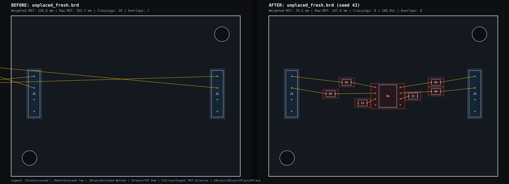

# Walkthrough — Phase 2 Coarse-to-Fine `place` on `unplaced_fresh.brd` (2026-11-25)

## Before & After (`eagle6-placer place --candidates 3 --preview`)


## Summary
- **Fixture:** `tests/fixtures/unplaced_fresh.brd` (50 × 35 mm board, 2 locked edge connectors `J1`/`J2`, 2 mounting holes, and 7 unlocked parts starting off-board at `x = -12..-18 mm`).
- **Command:**
  ```bash
  eagle6-placer place tests/fixtures/unplaced_fresh.brd \
    --steps 2000 --seed 42 --candidates 3 --keep-all-candidates --preview
  ```
- **Results (Best Candidate: `seed=43`):**
  - **Weighted MST:** `236.62 mm → 70.18 mm` (-70.3%)
  - **Raw MST:** `355.70 mm → 146.97 mm` (-58.7%)
  - **Signal Airwire Crossings:** `18 → 0` (-100%)
  - **Congestion Penalty:** `2.00 → 0.00`
  - **Off-Board / Overlap Violations:** `7 → 0` (`Audit: PASS`)
  - **Staged EAGLE v6.6.0 DRC (`validate_edit_script`):** `success=true`, `exit_code=0`, **0 DRC errors**.
