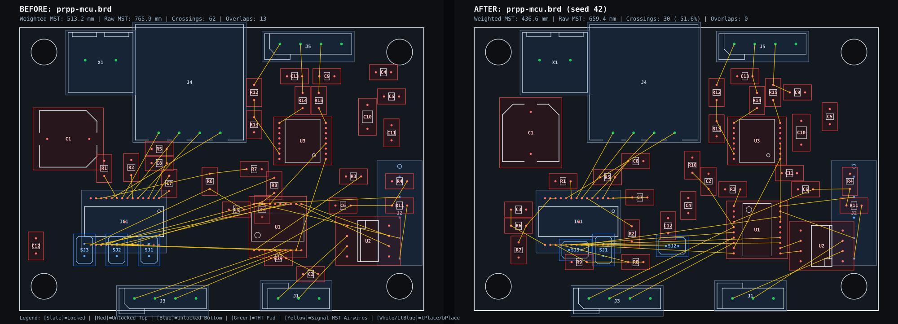

# `prpp-mcu.brd` — Before & After Local Polish Walkthrough (2026-11-25)

## Side-by-Side Comparison (`tPlace`/`bPlace` Active)

## Summary Metrics
- **Input:** `tests/fixtures/user-provided/prpp-mcu.brd` (read-only, untouched; ignored via `.gitignore`)
- **Command:** `eagle6-placer polish tests/fixtures/user-provided/prpp-mcu.brd --preview --steps 6000 --seed 42`
- **Board:** `50.0 × 35.0 mm`, 2-layer `(1*16)`, 41 components (**7 locked**: `IC1`, `J1`–`J5`, `X1`; **34 unlocked**: 30 modified).
- **Pour-net via handling:** Existing `GND` / `VMOT` pour-net vias ignored by default (no `--allow-routed` required; routed signal nets remain guarded).

| Metric | Before | After | Delta |
| :--- | ---: | ---: | ---: |
| **Weighted MST Wirelength** | 513.21 mm | 436.60 mm | **-76.61 mm (-14.9%)** |
| **Raw MST Wirelength** | 765.90 mm | 659.38 mm | **-106.52 mm (-13.9%)** |
| **Signal Airwire Crossings** | 62 | 30 | **-32 (-51.6%)** |
| **Courtyard/Hole Overlaps** | 13 | 0 | **-13 (100% legalized)** |
| **Total Objective Cost** | 4073.21 | 611.40 | **-3461.81** |
| **Constraint Audit** | FAIL (13) | **PASS (0)** | **0 violations** |
| **EAGLE v6.6.0 Staged DRC Errors** | 1 | 1 | **0 new errors** |

## Notable Placement Improvements
- **Zero-Overlap Legalization (`13 → 0`):** All 13 pre-existing courtyard and mounting-hole overlaps—including `C7`, `C8`, and `R5` originally wedged between locked `IC1` and `J4`—were cleanly separated with zero violations.
- **`U1` (STM32, TSSOP20) & `U2` (SO-8):** `U1` rotated `R0 → R270` and `U2` rotated `R270 → R90`, aligning pins directly toward `IC1` and `U2` and cutting raw MST wirelength by `106.5 mm` and airwire crossings in half (`62 → 30`).
- **Invariants Preserved:** All 7 locked parts (`IC1`, `J1`–`J5`, `X1`) stayed strictly immobile, and bottom-side solder jumpers (`SJ1`–`SJ3`) stayed on the bottom layer.

## Staged Verification
Dry-run of the generated `.scr` script via `eagle6-mcp` (`validate_edit_script` with `run_checks=true`) exited `0` (`success=true`), applied all 30 moves/rotations accurately in real CadSoft EAGLE v6.6.0, and introduced **0 new DRC errors**.
